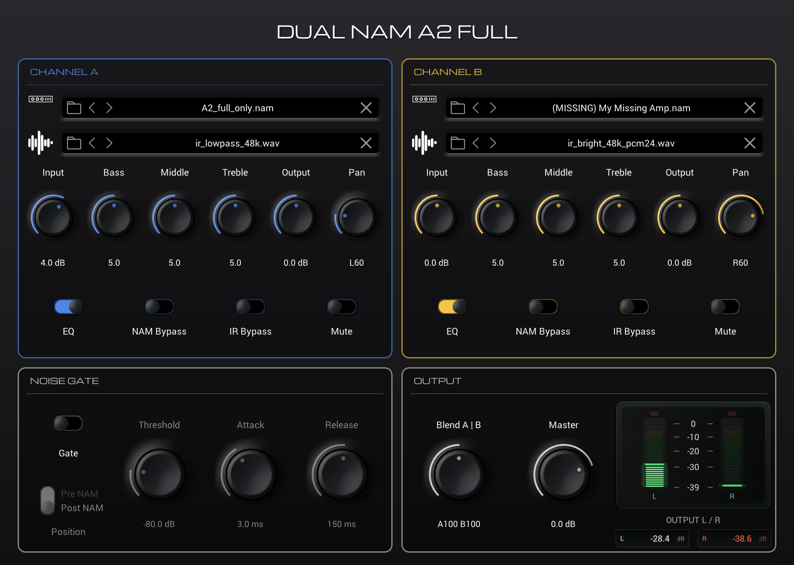

# Dual NAM A2 Full

A lean Windows x64 VST3 with **two independent Neural Amp Modeler engines** (A2 Full, also
A1/LSTM) and **two IR loaders**. A mono guitar signal feeds both channels; each channel has its
own model, its own IR, its own levels and its own pan position, and the output is true stereo.
A built-in noise gate can sit before or after the models.



## Download

**Version 1.2.0 (Windows x64, VST3):**
[DualNAM_A2_Full-1.2.0-win-x64.zip](https://github.com/AGW-Germany/Dual-NAM-A2-Full/releases/download/v1.2.0/DualNAM_A2_Full-1.2.0-win-x64.zip)

SHA-256: `4641CF28E5E80D28DD5D232C1FCC9F53E80E8251846B53D44186C7EB273A40DB`

All releases: [Releases](https://github.com/AGW-Germany/Dual-NAM-A2-Full/releases)

This is a public test release. Feedback and bug reports are welcome via
[Issues](https://github.com/AGW-Germany/Dual-NAM-A2-Full/issues).

## Signal flow

```
                  MONO INPUT          (stereo bus: left input only)
                      |
                      +------------> gate detector (one envelope)
                      |
                [Gate, Pre NAM]
                      |
            +---------+---------+
            |                   |
        CHANNEL A           CHANNEL B
        Input Gain          Input Gain
        NAM (A2 Full)       NAM (A2 Full)
      [Gate, Post NAM]    [Gate, Post NAM]   (same envelope)
        EQ (B/M/T)          EQ (B/M/T)
        IR Loader A         IR Loader B
        Output Gain         Output Gain
        Mute / Blend        Mute / Blend
        Pan                 Pan
            +---------+---------+
                      |
                Master Output
                      |
                STEREO OUTPUT
```

## Requirements

* Windows 10 or 11, 64-bit, x64 CPU (SSE2 is enough, no AVX required)
* A VST3 host, e.g. Studio One 8 Pro
* NAM models (`.nam`) and mono IRs (`.wav`)

## Installation

1. Download and unzip `DualNAM_A2_Full-1.2.0-win-x64.zip`.
2. Open **PowerShell as administrator**, change into the unzipped folder and run
   `powershell -ExecutionPolicy Bypass -File .\Install.ps1`. The script
   * first checks that the package is complete and stops without changing anything if it is not,
   * copies the folder `Dual NAM A2 Full 1.2.0.vst3` to `C:\Program Files\Common Files\VST3\`, and
   * replaces older copies of this plug-in (only folders named `DualNAM_A2_Full.vst3` or
     `Dual NAM A2 Full <version>.vst3` whose DLL identifies itself as Dual NAM A2 Full). If an
     old copy is in use (e.g. the DAW is still running), nothing is changed; close the DAW and
     run the script again.

   **By hand:** delete any older `DualNAM_A2_Full.vst3` or `Dual NAM A2 Full ….vst3` folder from
   the VST3 folder, then copy the **folder** `Dual NAM A2 Full 1.2.0.vst3` (the whole folder,
   not just the file inside it) to `C:\Program Files\Common Files\VST3\`.
3. Start your host and rescan plug-ins if necessary.
4. The plug-in appears as **Dual NAM A2 Full** (vendor *ADLER GUITAR WORKS*, category *Fx*).

Keep only one copy installed: every version has the same VST3 class ID, so two copies side by
side would be the same plug-in twice for the host. The plug-in has its own IDs and does not clash
with the original NAM plug-in or with Gateway Stereo Plus.

**Uninstall:** delete the folder `C:\Program Files\Common Files\VST3\Dual NAM A2 Full 1.2.0.vst3`.

The full user guide (controls, gate, routing, sample rate, presets, limitations) is the
`README.md` inside the download.

## Features

* Two independent NAM engines; A2 files always play their **full size (A2 Full)**, no "Slim"
  control. A1 and LSTM models are supported too. Inference uses the official, unmodified
  NeuralAmpModelerCore.
* Two mono IR loaders, 3-band EQ, input/output gain, constant-power pan, mute and bypasses per
  channel; blend and master.
* Noise gate with threshold, attack (0.1–50 ms), release (10–1000 ms) and a **Pre NAM / Post NAM**
  position switch; one detector on the guitar signal and one shared envelope for both channels;
  no latency, click-free switching.
* Fixed input routing: mono bus → both channels at full level; stereo bus → left input only.
* Automatic resampling and exact latency alignment when models and project rates differ.

## Known limitations

* Windows x64 VST3 only (no AU/AAX/macOS build).
* Mono IRs only; direct IR convolution, max. 8192 samples, as in the NAM plug-in.
* When resampling (e.g. 44.1 kHz projects with 48 kHz models), the NAM project's resampler limits
  accuracy (about −39 dB residual at 1 kHz). 48 kHz projects are not affected.
* Tested by the author in Studio One 8 Pro; other hosts have been checked with the Steinberg
  VST3 validator only.

## Source code

The source code of the plug-in is not published at this time; this repository contains the
release information and the license notices. The plug-in is built on the following open-source
projects (exact licenses in [LICENSES/ThirdPartyNotices.txt](LICENSES/ThirdPartyNotices.txt)):

* [Gateway Stereo Plus](https://github.com/Naaxas/GatewayStereoPlus) (MIT), a fork of the
  [Neural Amp Modeler plug-in](https://github.com/sdatkinson/NeuralAmpModelerPlugin) (MIT)
* [NeuralAmpModelerCore](https://github.com/sdatkinson/NeuralAmpModelerCore) v0.5.3 (MIT),
  unmodified
* [AudioDSPTools](https://github.com/sdatkinson/AudioDSPTools) v0.1.2 (MIT)
* [iPlug2](https://github.com/iPlug2/iPlug2) (zlib-style license; the
  [NAM fork](https://github.com/sdatkinson/iPlug2) is used), Steinberg VST3 SDK 3.8 (MIT)
* [Eigen](https://gitlab.com/libeigen/eigen) (MPL-2.0), unmodified. The exact Eigen source used
  is available from https://gitlab.com/libeigen/eigen at commit
  `ed8cda3ce4cb9d12640f9236fed968655a93b604`.

## Credits and disclaimer

Dual NAM A2 Full is developed by **Manuel Adler, ADLER GUITAR WORKS**
(manuel.adler@ais-moers.de).

Neural Amp Modeler is by **[Steven Atkinson](https://github.com/sdatkinson)**, with
[Oli Larkin and contributors](https://github.com/sdatkinson/NeuralAmpModelerPlugin/graphs/contributors):
the models, the training code, the inference engine and the plug-in this is built on are their
work. Gateway Stereo Plus (© 2026 Tunc M Sengiz) is the direct basis of this project.

Development of Dual NAM A2 Full was assisted by AI-based coding tools under human direction, testing, and review.

This is an independent project. It is **not affiliated with or endorsed by** Steven Atkinson,
the Neural Amp Modeler project, or the authors of Gateway Stereo Plus. "NAM" and "Neural Amp
Modeler" are used only to describe compatibility with NAM model files.

## License

The plug-in is licensed under the MIT License, see [LICENSE](LICENSE):
© 2022 Steven Atkinson, © 2026 Tunc M Sengiz, © 2026 Manuel Adler, ADLER GUITAR WORKS.

Third-party notices and the full license texts are in [LICENSES/](LICENSES/)
(start with [ThirdPartyNotices.txt](LICENSES/ThirdPartyNotices.txt)); the same files are included
in the download and inside the installed plug-in (`Contents/Resources`).

VST is a trademark of Steinberg Media Technologies GmbH.
